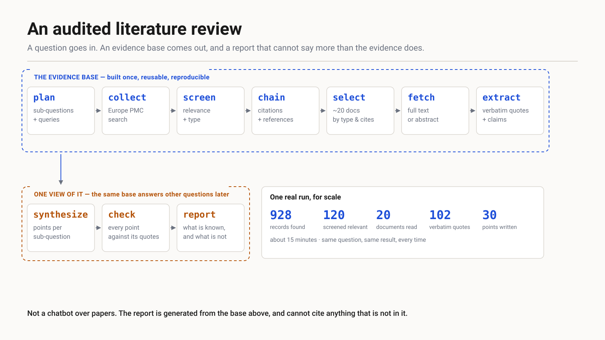
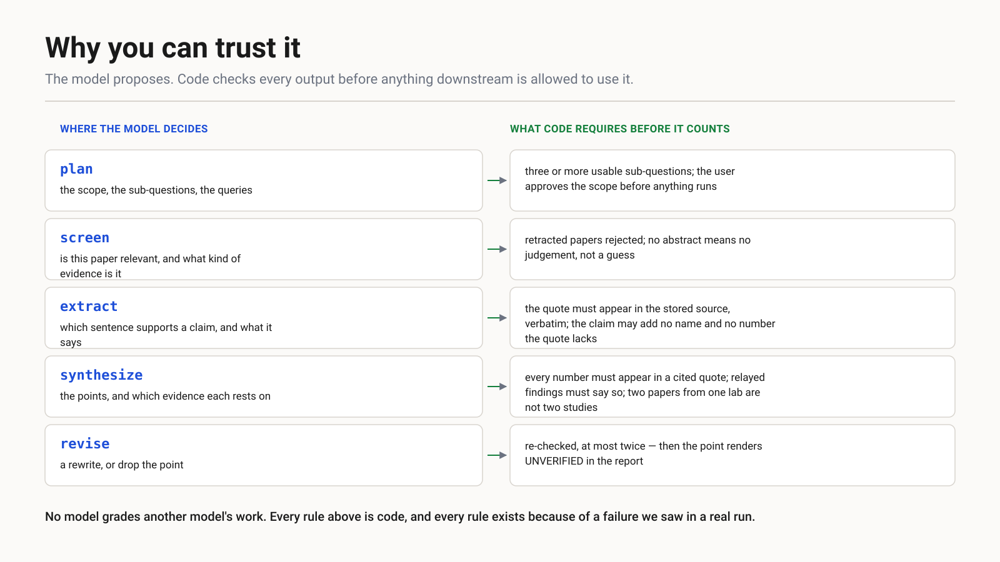
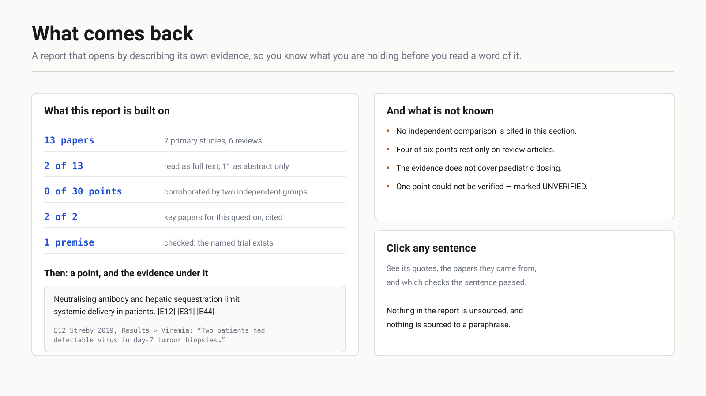

# openclaw-harness

Tools for getting language models to do literature and analysis work that a scientist can actually check.

The main piece is the **evidence lake**. You ask a research question and get back a report where every sentence points to a verbatim quote from a named paper. Anything that couldn't be verified is labelled as unverified.

> **Status: research prototype.** I use it on real questions, but it isn't packaged for other people yet. It also works on a narrower range of questions than that description suggests. The limits are spelled out below.



## Why I built it

Ask a general-purpose model to review a literature and you get fluent prose with plausible citations. Some of those citations don't say what the text claims, and now and then a cited paper doesn't exist. The only way to find out which is to read everything yourself. At that point the tool hasn't saved you any time.

The usual fix is to have a second model check the first. That doesn't work well. Models are poor at spotting their own errors, and a second model agrees with the first more often than it catches it.

## The approach

Every model output goes through checks written in code before the next stage can use it:

- A quote has to appear verbatim in the stored text of its source. Close isn't good enough.
- A claim can't introduce a name or a number that its quote doesn't contain.
- Every number in a written point has to appear in one of the quotes that point cites.
- When a paper reports someone else's result, the report has to present it as relayed. It can't present it as that paper's own finding.
- Two papers from the same lab can't count as two independent studies.
- A point that still fails after two rewrites stays in the report, marked **UNVERIFIED**, instead of being quietly dropped.

I added each rule after a specific failure in a real run. [CONTROLS.md](CONTROLS.md) lists them all. Each entry records the incident behind the rule, the test that exercises it in both directions, and the condition under which the rule should be removed.



## What you get back

A report that opens by describing its own evidence:

- how many papers it drew on
- how many are primary studies and how many are reviews
- how many were read in full and how many only from the abstract
- how many points are backed by two independent research groups
- what was searched for and not found

Then come the findings, each listing the evidence ids behind it, and a section on what the evidence doesn't cover.



You also get the evidence base itself. It's a directory holding the search records, screening decisions, selected papers, stored full text and extracted quotes. You can ask a second question of the same base without searching again. Anyone reviewing a report can trace a sentence to its source without rerunning anything.

## How it works

The pipeline has ten stages plus one side branch:

```
plan → collect → screen → chain → select → fetch → extract   │   synthesize → check → report
                 builds the evidence base                     │   writes one report from it
```

The first seven stages build the evidence base, and the last three write a report from it. The split is deliberate. The base is the part that lasts, and a report is one reading of it.

Each stage saves its output, and the pipeline skips stages that are already finished, so an interrupted run picks up where it stopped. [docs/architecture.md](docs/architecture.md) covers each stage: what it reads, what it decides, what the code checks, and the default value of every threshold.

## Quickstart

You'll need:

- Python 3
- R, for the Europe PMC search scripts
- a local model served by [Ollama](https://ollama.com)

Copy `config.env.example` to `config.env` and set your model there. Then:

```
python3 engine/lake/lake.py run "what are the barriers to intravenous delivery of oncolytic viruses?"
```

The pipeline first shows you the scope and sub-questions it plans to use, and waits for your approval. Read them carefully. The scope decides which evidence counts. A scope can be a reasonable reading of your question and still be the wrong one, and then you get a confident report built on a quiet mistake. [docs/scope.md](docs/scope.md) explains more.

With the current defaults, a run takes about an hour, mostly spent screening search results. When it finishes:

```
python3 engine/lake/lakemap.py <lake>    # where everything went: the funnel, what was dropped, key-paper recall
python3 engine/lake/review.py  <lake>    # a browsable page: click a sentence to see its evidence
```

## Where it works, and where it doesn't yet

These numbers come from my development runs in late October 2026. The run data isn't included in this repo.

**It does well on questions that compare named things**, such as "which doublet-detection method performs best?" On a five-question development set, it found, selected and cited the key papers 6 times out of 6.

**It struggles with mechanism questions**, such as "does X cause Y?" or "what are the barriers to Z?" I tested a held-out set of four such questions. The pipeline found 6 of the 7 key papers but cited only 4, and none of the four reports cited a single independent study.

I know the cause. The screening step sorts papers by evidence type, and the type it protects most strongly is "a paper comparing several methods." A mechanism question has no papers of that type. So the most useful papers have nothing protecting them when the selection is cut down.

| Limit | What it means for you |
|---|---|
| Weak on mechanism questions | Reports lean heavily on reviews. They say so, but they can't make up for it |
| Europe PMC only | Biomedical literature only, for now |
| Open-access full text only | Other papers are read from the abstract alone, and the report marks which ones |
| 20 documents per question by default | I chose this number rather than deriving it. On a dense literature, it's the binding constraint |
| Little corroboration | In one recent run, 0 of 30 points were backed by two independent groups. The report states this. It can't fix it |

This isn't a chatbot over papers, a citation manager, or a replacement for a systematic review. It covers the first pass of a review: the searching, screening, reading and quoting. It does that work in a form someone else can check.

## The three promises, and the tests behind them

| Promise | Enforced by | Test |
|---|---|---|
| Every quote is verbatim | `verify.find_quote` | `test_lake find_quote` |
| A claim says no more than its quote | `verify.claim_issues` | `test_lake claim_issues` |
| It reports absence honestly | premise check + summary rule | `test_lake premise` |

Each promise has a test that fails if the promise breaks. If you add a promise to this README, please add its test in the same commit. `bash engine/tests/run.sh` runs the full suite.

## Measuring quality

Checking that each sentence matches its quote is the easy part. Judging whether a whole report answers the question well is harder, and that problem is still open.

`engine/lake/score.py` is a frozen scorer written entirely in code. It measures key-paper recall, whether every quote is found in its source, and whether every number is supported. It doesn't import the pipeline, so a pipeline change can't quietly change the score.

I'm also evaluating an LLM judge (`engine/lake/judge.py`) against problems I labelled by hand. So far it catches 4 of 12. For now it flags reports for a person to read, and its verdicts don't count toward the score.

## The agent harness

The repo is named after its first part: plugins and evaluation packs for OpenClaw agents doing single-cell analysis. It's built on the same idea as the evidence lake, which is to enforce checks in code instead of trusting the model.

- **`engine/extensions/grounded`** makes agents ground their work. Before running an analysis, an agent writes a research brief citing pages it actually opened. Questions about current facts trigger a reminder to search first, and code is checked for invented parameters and versions.
- **`engine/extensions/audit-gate`** sends the work to a separate, read-only auditor agent. An audit only counts as a pass if the auditor actually ran checks. It can't pass work that its own premise check flagged.
- **`packs/`** holds the evaluation question sets, each with known answers or key papers.

## Repository

```
engine/lake/          the evidence-lake pipeline, its prompts, and read-only tools
engine/extensions/    OpenClaw plugins: grounding and the audit gate
engine/agents/        instructions for the worker and auditor agents
engine/tests/         the test suite (run.sh runs it all)
packs/                question sets with known answers, used for evaluation
CONTROLS.md           every check, the incident behind it, its test, and when to remove it
docs/                 architecture, scope design, report anatomy
```

## License

MIT. See [LICENSE](LICENSE).
