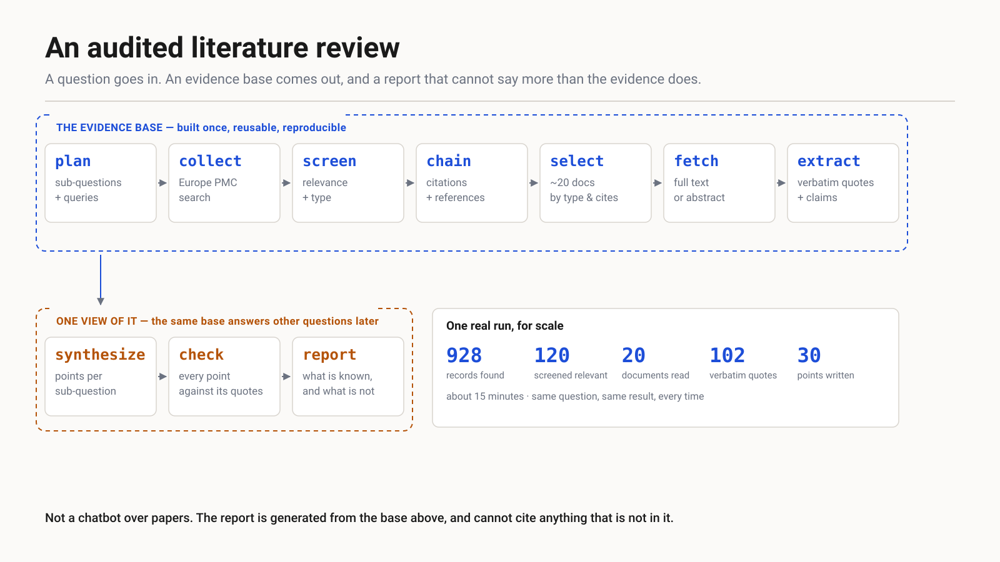
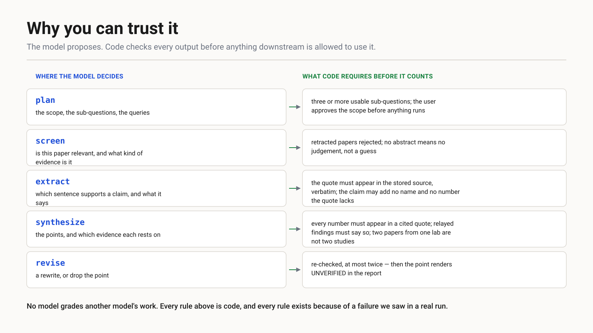
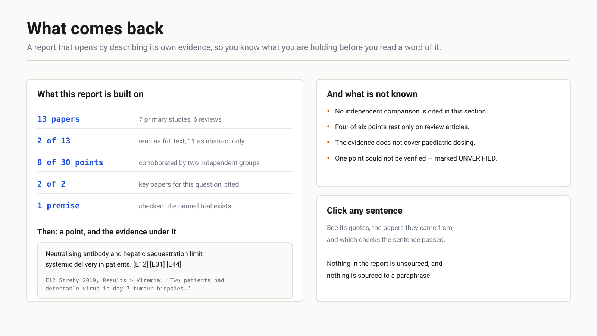

# Architecture

Eleven stages. Seven build an evidence base; three build one report from it; one is a side
branch. The boundary is the point of the design.



## The boundary

```
plan → collect → screen → chain → select → fetch → extract   │   synthesize → check → report
──────────────── the evidence base (the product) ───────────  │   one consumer of it
```

The base is files: records, screening decisions, selected documents, stored full text, extracted
quotes. The report is one reading of it. A second question, a different synthesis, or a reviewer
checking a sentence all work against the same base without searching again.

This matters commercially as much as technically: **the durable asset is the base, not the
report.** A report is read once. A base can be asked new questions for as long as the literature
stands still.

## Where model judgement enters



Nine model calls, each with a code guard. The guards are listed in full in
[CONTROLS.md](../CONTROLS.md) with the incident that produced each one.

What nothing checks, stated plainly: whether a paraphrase that adds no name and no number is
faithful; whether a paper is truly in scope; whether the synthesis weighs the evidence well. The
first and third are open problems. The second is what [scope.md](scope.md) addresses.

## What comes out



See [report-anatomy.md](report-anatomy.md).

## Stage reference

`WORKFLOW.md` in the repository root carries the full stage-by-stage description: what each stage
reads and writes, every threshold with its live default, every rule that drops or rejects
something and where that is logged, and the real dependency graph against the positional stage
list.

Two structural notes worth knowing before reading it:

- **`profile` sits before `synthesize` in the stage list and nothing reads its output**, so
  re-running it discards synthesis, check and report for nothing. It is a side branch in the
  wrong position.
- **`manifest.scripts` hashes are written only at lake creation**, so a lake that outlives a code
  change misreports the code that built it. Any run used for measurement should be built fresh.

## Evaluation

`packs/` holds question sets with known key papers. `eval.py` runs them; `lakemap.py` reports,
per case, where each key paper ended up at three depths — found by the searches, selected for
reading, cited in the report. A paper lost at `collect` and a paper lost at `select` present the
same symptom and need opposite fixes, which is why the funnel is reported rather than a score.

The standing rule: **one case is not a result.** A change measured on a single question is a
hypothesis until the packs agree.
